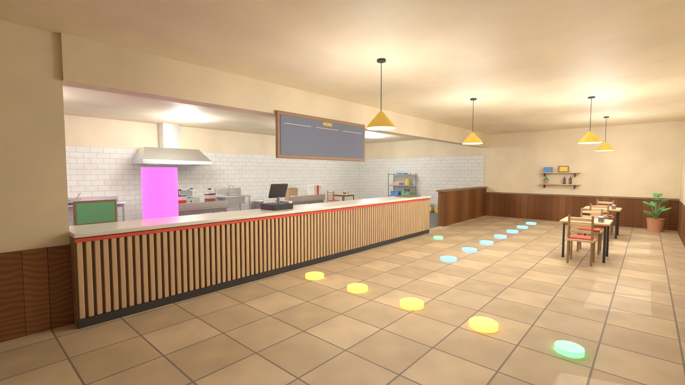
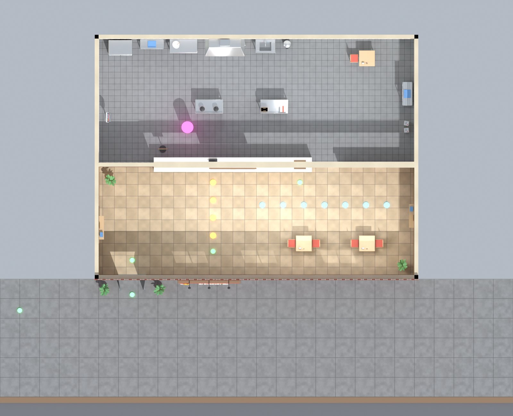
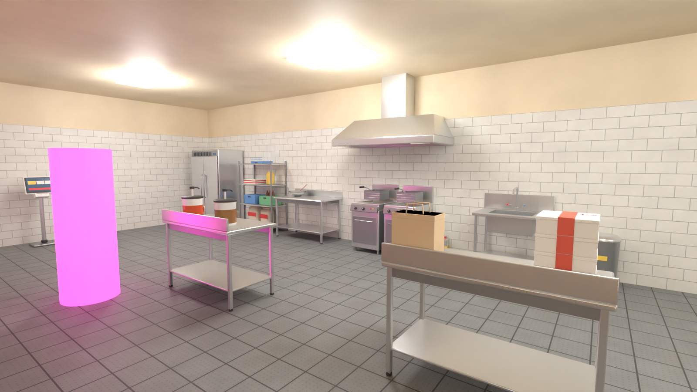
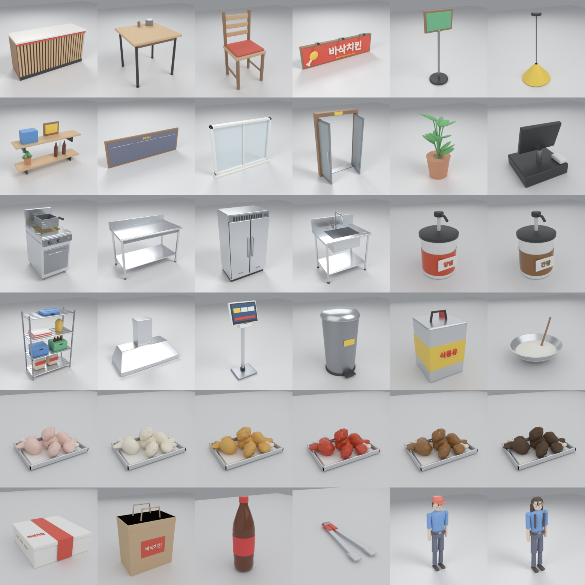

# 바삭치킨 시뮬레이터 — Unity 3D 1인칭 치킨집 운영 게임

Unity **2022.3.62f1** · C# · Built-in Render Pipeline · 기본 Input Manager · 싱글플레이

플레이어는 치킨집 직원 겸 사장입니다. 1인칭으로 매장을 돌아다니며 주문을 받고, 생닭을 꺼내 반죽하고, 튀기고, 소스를 바르고, 포장해서 손님에게 전달합니다. 영업이 끝나면 정산을 확인하고, 번 돈으로 재료를 사고 장비를 업그레이드한 뒤 다음 날 영업을 이어 갑니다.



> 위 이미지는 Unity 씬 빌더의 배치 좌표를 Blender로 재현해 렌더링한 **레이아웃 미리보기**입니다(Unity 실행 화면이 아님). 실제 게임에서는 Unity 조명·재질·UI가 적용됩니다.

---

## 1. 빠른 시작

1. **Unity Hub → Add → 이 폴더(저장소 루트)** 를 선택하고 Unity **2022.3.62f1** 로 엽니다.
   - 처음 열 때 패키지(uGUI)와 에셋(FBX 35개, 텍스처, 폰트)을 가져오느라 몇 분 걸립니다.
2. 상단 메뉴 **Chicken Shop → Create Game Scene** 을 실행합니다. 이 메뉴가 자동으로:
   - FBX 가져오기 설정 확인(축 변환/스케일), 모델 머티리얼을 `Materials/Models/*.mat` 로 추출·공유
   - 바닥/벽 머티리얼 생성, 프리팹 생성(`Prefabs/Items`, `Prefabs/Stations`, `Prefabs/Customer.prefab`)
   - `Scenes/MainMenu.unity`, `Scenes/ChickenShop.unity` 생성 및 저장, Build Settings 등록
   - Color Space = Linear, Pixel Light Count ≥ 8 설정
3. 생성이 끝나면 `ChickenShop` 씬이 열립니다. **Play** 를 누르면 바로 새 게임이 시작됩니다.
   - 메인 메뉴(새 게임/이어하기)부터 시작하려면 **Chicken Shop → Open Main Menu Scene** 후 Play.
4. 빌드: File → Build Settings → (MainMenu, ChickenShop 이 등록되어 있음) → Build.

> NavMesh 베이크나 라이트맵 굽기는 필요 없습니다. 손님은 웨이포인트 경로로 움직이고, 조명은 전부 실시간입니다.

## 2. 조작법

| 키 | 동작 |
|---|---|
| W A S D | 이동 |
| 마우스 | 시점 회전 |
| Shift | 달리기 |
| Space | 점프 |
| **E** | 바라보는 작업대/손님과 상호작용 |
| Tab | 주문·재고 관리 화면 (시간은 계속 흐름) |
| ESC | 창 닫기 / 일시정지 메뉴(커서 해제, 시간 정지) |
| Left Alt (누르는 동안) | 커서 잠시 해제 — 영업 중 UI 클릭용 |
| F1 | 도움말 |
| F10 (에디터/개발 빌드) | 영업 루프 자동 검증 실행 |
| F9 (에디터/개발 빌드) | 개발용 자금 +100,000원 |

## 3. 게임 루프

```
영업 팻말 [E] 영업 시작 ─▶ 손님 입장·줄 서기 ─▶ 카운터에서 [E] 주문 접수 (POS 도 가능)
   ─▶ 냉장고 [E] 생닭(생닭 -1) ─▶ 반죽 작업대(튀김가루 -1, 3초) ─▶ 튀김기(식용유 -1, 14초, 방치하면 10초 뒤 탐)
   ─▶ (양념/간장 주문) 소스통(소스 -1, 2.5초) ─▶ 포장 작업대(상자·봉투 -1, 음료 주문이면 콜라 -1, 3초)
   ─▶ 픽업대 또는 손님에게 [E] 전달 ─▶ 결제(매출) + 만족도(★1~3) + 평판 + 팁
   ─▶ 마감(23:00 또는 조기 마감) ─▶ 남은 손님 응대 ─▶ 일일 정산(운영비 청구, 자동 저장)
   ─▶ 발주 단말기에서 재료 구매 · 업그레이드 · 메뉴 해금 ─▶ 다음 날
```

- 튀김기에 넣는 순간 **가장 오래 기다린 주문에 자동 배정**되고(티켓 상태 '조리 중'), 소스/포장 단계에서 메뉴가 다르면 같은 메뉴의 다른 주문으로 재배정됩니다.
- **포장되지 않은 음식은 전달 불가**, **완성되지 않은(반죽/생닭/탄) 치킨은 포장 불가**, **결제는 주문당 1회**(중복 결제 차단).
- 손님 대기 시간이 0이 되면 주문 실패 → 손님이 화내며 퇴장, 평판 -6. 카운터에서 주문을 못 하고 떠나면 평판 -3.
- 영업 준비 단계에서는 게임 시계가 멈춥니다(미리 튀겨 둘 수 있음 — 나중에 들어온 주문에 연결됨).

### 기본 수치 (모두 Inspector 에서 변경 가능)

| 항목 | 값 | 위치 |
|---|---|---|
| 시작 자금 | 120,000원 | `EconomyManager` |
| 하루 운영비 | 45,000원 + 업그레이드 유지비 | `EconomyManager`, `ShopProgression` |
| 후라이드 / 양념 / 간장(해금) / 콜라 | 18,000 / 19,500 / 21,000 / +2,000원 | `MenuCatalog` |
| 생닭·튀김가루·식용유·양념·간장·상자·봉투·콜라 단가 | 6,000·400·600·700·800·500·200·1,000원 | `InventoryManager` |
| 기본 튀김 시간 / 과조리까지 | 14초 / 10초 (간장은 x1.15) | `FryerStation`, `MenuCatalog` |
| 반죽 / 소스 / 포장 시간 | 3 / 2.5 / 3초 | 각 `WorkStation` |
| 음식 대기 인내심 / 주문 대기 | 150초 / 45초 | `OrderManager`, `CustomerSpawner` |
| 영업 시간 | 17:00~23:00, 게임 1분 = 0.8초(약 4.8분) | `DayCycleManager` |
| 손님 방문 간격 | 26초 × 평판 보정(1.5~0.6) ÷ 홍보 배율 | `CustomerSpawner` |

### 성장 요소
| 업그레이드 | 효과 | 조건 |
|---|---|---|
| 고화력 버너 (Lv3) | 튀김 시간 -15%/Lv | 1일차~ |
| 튀김기 증설 | 2번 튀김기 잠금 해제 | 2일차~ |
| 전문 조리 도구 (Lv2) | 반죽·소스·포장 -20%/Lv | 1일차~ |
| 인테리어 개선 (Lv3) | 손님 인내심 +15%, 평판 상승 +10% /Lv | 2일차, 평판 45 |
| 전단지 홍보 (Lv3) | 손님 방문 +20%/Lv | 2일차, 평판 50 |
| **간장치킨 메뉴 해금** | 간장 소스통 사용 + 간장치킨 주문 시작 | 2일차, 평판 55, 70,000원 |

### 매장 배치 (레이아웃 미리보기)

| 평면도 (위: 주방, 아래: 홀/입구) | 주방 |
|---|---|
|  |  |

평면도 표식: 노란색 = 줄 서기 자리(맨 위가 주문 위치), 파란색 = 주문 후 대기 자리, 초록색 = 입구/생성/픽업 경유지, 분홍색 = 플레이어 시작 위치.
주방 뒷벽: 냉장고 · 재료 선반 · 반죽 작업대 · 튀김기 2대(후드) · 싱크 · 쓰레기통 / 가운데 섬: 양념·간장 소스통, 포장 작업대 / 왼쪽 벽: 발주 단말기 / 카운터: 영업 팻말, POS, 픽업대.

## 4. 폴더 구조

```
Assets/ChickenShop/
  Scripts/
    Core/       GameManager, DayCycleManager, ReputationManager, InputModeManager, ShopOpenSign,
                GameLoopSelfTest, GameLog, GameLaunchOptions
    Core/Logic/ 순수 C# (Unity 비의존): GameEnums, InventoryStock, Wallet, DailyReport, MoneyFormat
    Player/     PlayerController, PlayerInteractor, PlayerCarry, Interactable
    Orders/     OrderData, OrderBook(순수 로직), OrderManager, MenuCatalog, SatisfactionRules, OrderTakingPoint
    Kitchen/    ChickenItem, ItemFactory, WorkStation(기반), PrepStation, FryerStation, SauceStation,
                PackagingStation, IngredientFridge, DeliveryCounter, TrashBin, WorldLabel, WorldProgressBar
    Customers/  CustomerSpawner, CustomerAgent, CustomerQueue, WaitingArea, CustomerAppearance, CustomerAnimator
    Economy/    EconomyManager, InventoryManager, ShopProgression, SupplyTerminal
    UI/         UIManager, HUDView, ToastView, UIPanel, OrdersInventoryPanel, ShopPanel, SettlementPanel,
                PausePanel, HelpPanel, MainMenuController, MenuBoardDisplay, UIFactory, UIFonts
    Save/       SaveData, SaveManager
  Editor/       ChickenShopSceneBuilder(메뉴), ChickenShopPrefabs, ChickenShopMaterials, ChickenShopModelPostprocessor,
                ChickenShopMeshUtil, ChickenShopFallbackModels, ChickenShopEditorUtil, ChickenShopTools
  Models/       Blender 가 생성한 FBX (Shop / Kitchen / Food / Props / Characters)
  Textures/     절차 생성 타일 텍스처 (바닥/벽/벽돌/목재/인도)
  Resources/Fonts/  나눔스퀘어라운드 R/B (SIL OFL 1.1, 라이선스 동봉)
  Materials/ Prefabs/ Scenes/   ← "Create Game Scene" 실행 시 생성됨
Blender/
  scripts/      모델별 생성 스크립트 + cs_common.py(공용) + build_all.py + 미리보기/레이아웃 렌더
  blend/        생성된 .blend 원본 (35개)
  previews/     모델/레이아웃 미리보기 PNG
Tests/LogicTests/  순수 로직 단위 테스트 (dotnet run)
Packages/manifest.json, ProjectSettings/ProjectVersion.txt
```

### 아키텍처 요약
- `GameManager` 는 시스템 참조·새 게임/불러오기·일시정지만 담당하고, 규칙은 각 매니저로 분리했습니다.
- 돈과 재고는 각각 `Wallet`, `InventoryStock` (순수 C#) 한 곳에서만 바뀝니다. 구매는 "자금 차감 성공 → 재고 증가", 작업은 "재고 전부 확인 → 전부 차감" 순서로 원자적으로 처리됩니다.
- 주문 상태/배정/결제는 `OrderBook` 이 관리합니다. `TryComplete` 는 `Packed` + 미결제 + 배정 아이템 일치일 때만 성공하고 즉시 `isPaid` 를 세워 중복 결제를 막습니다.
- 모든 상호작용 대상은 `Interactable` 을 상속하고, 시간이 걸리는 작업대는 `WorkStation` 을 상속합니다(올리기 → 진행 막대 → 꺼내기).
- UI 는 런타임에 코드로 구성(uGUI)하므로 씬에 직렬화된 UI 참조가 깨질 일이 없습니다. 패널이 열리면 `InputModeManager` 가 커서를 풀고 시점/이동/상호작용을 막습니다.
- 매 프레임 객체 탐색 없음: 참조는 Awake/Start 에서 한 번, HUD 문자열은 값이 바뀔 때만(0.2초 간격) 갱신, 레이캐스트 대상은 Collider 캐시.
- 모든 로그는 `[ChickenShop/태그]` 접두사로 출력됩니다.

## 5. Blender 3D 모델 파이프라인

모든 3D 모델은 `Blender/scripts/` 의 Python 스크립트로 **이 저장소에서 실제로 생성**했습니다 (Blender 5.1 bpy 모듈). 결과물(`.blend` 35개, `.fbx` 35개)이 함께 커밋되어 있어 Blender 없이도 Unity 에서 바로 사용할 수 있습니다.

| 분류 | 모델 (FBX 이름) | 삼각형 수 |
|---|---|---|
| 매장 | Counter, Table, Chair, ShopSign, OpenSign, PendantLamp, WallShelf, MenuBoard, Window, DoorFrame, Plant, PosRegister | 0.5k~13k |
| 주방 | Fryer(+Basket), Worktable, Fridge, Sink, SauceTub_Yangnyeom/Ganjang, StorageRack, ExhaustHood, OrderTerminal | 1k~4.7k |
| 음식 | Chicken_Raw / Battered / Fried / Yangnyeom / Ganjang / Burnt (같은 형태, 표면만 다름) | 4.9k~5.8k |
| 소품 | ChickenBox, PaperBag, Tongs, OilCan, ColaBottle, TrashBin, BatterBowl | 0.5k~3.6k |
| 손님 | Customer (관절 분리형 베이스 + 헤어 3종, 모자, 안경, 가방) | 9.5k(전체 변형 포함) |



### 다시 생성하기
```bash
# 방법 1: Blender 설치본 (4.2 이상)
blender -b -P Blender/scripts/build_all.py
# 방법 2: bpy 파이썬 모듈 (Python 3.13)
pip install bpy==5.1.2 && python Blender/scripts/build_all.py
# 개별 모델:  python Blender/scripts/kitchen_fryer.py   /   미리보기: python Blender/scripts/render_preview.py Kitchen/Fryer
```

### FBX ↔ Unity 설정
- 단위: 1 Blender unit = 1 m = 1 Unity unit. 원점은 **바닥 중앙**(벽걸이/천장 모델은 부착면) → Unity 에서 y=0 에 놓으면 바닥에 붙습니다.
- 정면: Blender **-Y** 로 모델링 → Unity **+Z(transform.forward)**.
- 내보내기: `apply_scale_options=FBX_SCALE_ALL`, `axis_forward=-Z`, `axis_up=Y`, `mesh_smooth_type=OFF`(커스텀 노멀 유지), 모디파이어 적용.
- Unity 가져오기(`ChickenShopModelPostprocessor` 가 자동 적용): Scale Factor 1, Use File Scale, **Bake Axis Conversion**(루트 회전 0), Normals=Import, 카메라/라이트/애니메이션 제외, Collider 생성 안 함.
- 머티리얼: Blender 의 `M_*` 머티리얼 이름 그대로 FBX 에 들어가고, 빌더가 `Materials/Models/M_*.mat` 로 추출해 **모든 FBX 가 하나의 머티리얼을 공유**하도록 리맵합니다. 금속/광택/유리/발광은 이름 규칙으로 자동 보정됩니다.
- Collider: 프리팹 단계에서 모델 경계에 맞춘 단순 BoxCollider (손님은 CapsuleCollider). 별도 충돌 메시는 필요하지 않은 형태들입니다.
- 교체: 모든 프리팹은 루트(컴포넌트·Collider) + 자식 `Model`(FBX) 구조라, FBX 를 다시 내보내거나 `Model` 만 바꾸면 됩니다. FBX 가 없으면 빌더가 기본 도형 대체 모델을 만들어 게임은 계속 동작합니다.
- 애니메이션 부품: 튀김기 `Basket`(조리 중 하강), 영업 팻말 `Board`(OPEN/CLOSED 회전), 펜던트 `Bulb`(조명 위치), 손님 `Head/Arm_L/Arm_R/Leg_L/Leg_R`(관절 피벗).

### 캐릭터 리깅 대안
스킨드 메시 + 아마추어 대신 **관절별로 분리된 부품을 피벗 위치에 두고 계층으로 내보내는 방식**을 사용했습니다. `CustomerAnimator` 가 걷기(팔다리 교차 스윙, 몸 흔들림), 대기(숨쉬기, 고개 돌리기), 손 흔들기, 화남(고개 젓기)을 절차적으로 재생하므로 Animator Controller/Avatar 설정 없이 바로 동작합니다. 외형은 `CustomerAppearance` 가 헤어/모자/안경/가방 토글과 MaterialPropertyBlock 색상(피부·옷·바지·머리·액세서리)으로 손님마다 다르게 만듭니다.

## 6. 검증 결과

이 작업 환경에는 **Unity Editor 가 없습니다** (라이선스/다운로드 불가). 그래서 아래처럼 실행한 것과 실행하지 못한 것을 구분합니다.

### 이 환경에서 실제로 실행·확인한 것
| 항목 | 방법 | 결과 |
|---|---|---|
| C# 컴파일 (런타임) | .NET 8 SDK + Unity 2021.3 UnityEngine 모듈 + uGUI 참조 DLL, C# 9 | 오류 0, 경고 0 |
| C# 컴파일 (에디터 포함, `UNITY_EDITOR`) | 위 + UnityEditor.dll(2021.1) | 오류 0, 경고 0 |
| MonoBehaviour 파일명 = 클래스명 | 스크립트 검사 | 불일치 0 |
| 순수 로직 단위 테스트 36개 | `Tests/LogicTests` (`dotnet run`) | 36/36 통과 — 재고 원자적 차감, 잔액 부족 거부, 매출/운영비/순이익, 주문 배정·재배정, 포장 전 결제 거부, **중복 결제 거부**, 시간 초과, 원화 표시 등 |
| UI 문자열 글리프 | fontTools 로 나눔스퀘어라운드 R/B 에 코드 속 비ASCII 문자 366개 존재 확인 | 누락 0 (누락됐던 '≈' 는 교체) |
| Blender 모델 생성 | `build_all.py` 실행 → 35 FBX + 35 .blend | 35개 스크립트 성공, 실패 0 |
| FBX 재가져오기 | 생성된 FBX 를 다시 import 해서 루트 회전 0, 스케일 1, 크기(m), 바닥 원점, 머티리얼, 부품 이름/피벗 확인 | 정상 |
| 레이아웃 | 씬 빌더 좌표를 C# 소스에서 읽어 Blender 로 재현 렌더 (`preview_scene_layout.py`) | 작업대 겹침 없음, 동선 확인 |

### Unity 에서 확인이 필요한 것 (이 환경에서 실행 불가)
- `Chicken Shop > Create Game Scene` 실제 실행, Console 오류 여부, Play 모드 동작 전반 (이동/충돌/상호작용/UI/조명/성능).
- 위 항목은 **게임 안에서 F10** (또는 Play 중 메뉴 `Chicken Shop > Run Self-Test`)으로 자동 검증할 수 있도록 `GameLoopSelfTest` 를 넣었습니다. 새 게임 직후(영업 준비) 실행하면 실제 씬의 작업대/손님으로 한 번의 영업 루프를 수행하며 다음을 PASS/FAIL 로 Console 에 출력합니다:
  재료 구매 금액, 생닭/튀김가루/식용유/소스/상자/봉투/콜라 차감, 생닭 전달·포장·튀김 차단, 조리 진행도 증가, 조리 중 꺼내기 차단, 단계별 주문 상태, 결제 금액, 평판 상승, **중복 결제 차단**, 시간 초과 → 주문 실패·평판 하락·손님 퇴장, 마감 → 정산·운영비·순이익 공식, 자동 저장, 저장/불러오기 왕복(자금·재고·평판·날짜). 기존 저장 파일은 백업 후 복원합니다.
- 컴파일 확인은 Unity 2022.3 과 거의 같은 API 의 참조 DLL(런타임 2021.3, 에디터 2021.1)로 했습니다. 실제 2022.3.62f1 에서만 나타나는 API 경고(예: `FindObjectOfType` 사용 권장 변경)는 있을 수 있습니다.

## 7. 미구현 / 알려진 제한
- **사운드 없음** (튀김 소리, 효과음, BGM 미포함).
- 손님 애니메이션은 리깅이 아닌 관절 분리형 절차 애니메이션입니다. 앉기 동작 없음(대기석에 서서 기다림).
- NavMesh 대신 고정 웨이포인트 이동이라 매장 구조를 바꾸면 `Customers` 오브젝트의 경유지와 `CustomerSpawner` 의 통로 좌표(Inspector)를 함께 조정해야 합니다. 손님끼리는 자리 단위로만 겹침을 막습니다(지나가며 잠깐 겹칠 수 있음).
- 저장은 영업 준비/정산 단계에서만 가능합니다(영업 중 손님·조리 상태는 저장하지 않음). 정산 시·다음 날 시작 시 자동 저장.
- 주문은 손님 1명당 치킨 1마리(+콜라 선택)입니다. 반반/다중 수량 주문 없음.
- 재료 유통기한, 직원 고용, 배달 주문, 그래픽/키 설정 메뉴(마우스 감도 제외)는 없습니다.
- 프리팹/머티리얼/씬(.prefab/.mat/.unity)은 저장소에 없고 `Create Game Scene` 으로 생성됩니다 (Unity 없이 GUID 가 포함된 에셋 파일을 손으로 만들지 않기 위함).
- 대체 폰트: 나눔스퀘어라운드가 없으면 Unity 기본 폰트로 바뀌며 한글이 깨질 수 있습니다.

## 8. 문제 해결
- **메뉴 `Chicken Shop` 이 안 보임** → Console 의 컴파일 오류를 먼저 확인하세요. 스크립트가 컴파일되어야 메뉴가 생깁니다.
- **모델이 분홍색/회색 도형** → `Chicken Shop > Reimport Models And Share Materials` 실행 후 `Create Game Scene` 재실행. FBX 가 없다면 `build_all.py` 로 생성.
- **마우스가 잠기지 않음** → Game 뷰를 한 번 클릭하세요. ESC 는 일시정지/커서 해제입니다.
- **저장 초기화** → `Chicken Shop > Delete Save Data` (파일: `Application.persistentDataPath/chickenshop_save.json`).

## 9. 라이선스
- 코드, 3D 모델, 텍스처: 이 프로젝트에서 직접 생성 (외부 에셋 미사용).
- 폰트: 나눔스퀘어라운드 © NAVER Corporation, SIL Open Font License 1.1 (`Assets/ChickenShop/Resources/Fonts/LICENSE_Nanum_OFL.txt`).
